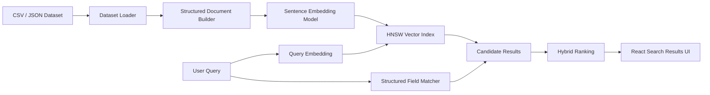

# Hybrid Structured Semantic Search Engine Using HNSW for Vehicle Dataset Retrieval

**Author:** Aditya / Project Team  
**Affiliation:** Department of Computer Science and Engineering  
**Paper Type:** IEEE-style research paper draft  
**Project:** AI-HNSW-Search  

---

## Abstract

Search systems that rely only on keyword matching often fail when user queries do not exactly match stored text. Fuzzy search improves tolerance for spelling differences, but it can also return unrelated results because it compares surface-level string similarity instead of meaning. For example, a query such as `BOXER-4` may incorrectly rank brands or models that share a few characters, while a query such as `Tesla` may show weakly related short strings because of character overlap. This paper presents a hybrid structured semantic search engine for vehicle dataset retrieval. The proposed system combines structured field matching, semantic sentence embeddings, and Hierarchical Navigable Small World (HNSW) approximate nearest neighbor search. Vehicle records are converted into enriched searchable documents containing brand, model, engine type, category, and original row fields. A sentence embedding model maps these enriched documents into vector space, while HNSW supports efficient similarity search. A structured boosting layer improves precision by giving additional weight to exact matches in important fields such as engine type, model, brand, and category. The hybrid ranking score combines semantic similarity with field-aware exact-match boosting, producing more meaningful results than pure fuzzy search or pure semantic search alone. The system is implemented using a FastAPI backend, a React frontend, and a custom HNSW index. The approach is especially useful for small to medium structured datasets where users may search by brand, vehicle model, engine type, or natural-language intent.

**Keywords:** semantic search, hybrid search, HNSW, approximate nearest neighbor, sentence embeddings, structured search, FastAPI, React, vehicle retrieval, information retrieval

---

## I. Introduction

Search is a core function in modern data-driven applications. Users expect a search system to understand both exact values and related meanings. In structured datasets, a user may search using a brand name, model name, engine type, category, or a natural-language description. A simple keyword search is often too strict because it requires exact token overlap. A fuzzy search is more flexible, but it can produce confusing results because it relies on character-level or edit-distance similarity rather than semantic meaning.

In the vehicle search project, early search behavior showed several practical problems:

- Only a small number of results were shown even when more records existed.
- Some results had identical scores because the ranking method did not properly distinguish field relevance.
- Fuzzy search returned records that did not truly match the query.
- Searching for an engine type such as `BOXER-4` returned unrelated brands because the algorithm compared surface text rather than structured meaning.
- Searching for a brand such as `Tesla` could show unrelated short names because they had some character similarity.

These issues show that search over structured vehicle records needs more than one retrieval method. Exact field matching is useful when the user searches for a known value such as `V8`, `GR86`, or `Toyota`. Semantic search is useful when the user enters broader phrases such as `sports coupe boxer engine` or `luxury performance sedan`. A hybrid method can combine the strengths of both.

This paper proposes and documents a hybrid structured semantic search engine. The system uses sentence embeddings to represent records semantically and HNSW to retrieve nearest neighbors efficiently. It also uses field-aware boosts to prioritize exact matches in important structured fields. The resulting search behavior is more explainable and more accurate for the vehicle dataset.

---

## II. Problem Statement

The main problem is to design a search system that retrieves relevant vehicle records from a structured dataset when the query may refer to:

- A brand or manufacturer, such as `Toyota`, `Ferrari`, or `Tesla`.
- A model, such as `GR86`, `Roma Spider`, or `Mustang GT`.
- An engine type, such as `BOXER-4`, `V8`, `I6`, or `BOXER-6`.
- A category or description, such as `sports coupe`, `grand tourer`, or `muscle car`.
- A natural-language combination, such as `sports coupe with boxer engine`.

The system should avoid the weaknesses of pure fuzzy search. In particular, it should not return unrelated results only because strings share a few characters. It should also avoid the weakness of pure semantic search, where exact structured values may not receive enough priority. For example, if the query is `BOXER-4`, records with `engine = BOXER-4` should rank above records that are only semantically related to engines in general.

The goal is to build a ranking system that is:

- **Accurate:** relevant records should appear near the top.
- **Explainable:** the system should show why a record matched.
- **Flexible:** it should support both exact field queries and natural-language queries.
- **Efficient:** it should use vector indexing to avoid slow exhaustive search for larger datasets.
- **Practical:** it should integrate with the existing FastAPI and React application.

---

## III. Objectives

The objectives of this project are:

1. To convert uploaded CSV or JSON vehicle datasets into structured searchable documents.
2. To preserve original fields such as brand, model, engine type, price, and category.
3. To generate enriched text descriptions from structured rows for semantic embedding.
4. To encode each document using a sentence embedding model.
5. To insert document vectors into an HNSW index for approximate nearest neighbor retrieval.
6. To combine semantic similarity with exact structured-field matching.
7. To display search results with hybrid score, semantic score, exact-match boost, field values, and match reasons.
8. To support more than one matching result by using a configurable top-k result limit.
9. To reduce irrelevant fuzzy matches by removing character-only fuzzy ranking.
10. To provide a search architecture suitable for IEEE-style academic presentation.

---

## IV. Background

### A. Keyword Search

Keyword search retrieves documents that contain the same words or tokens as the query. It is simple and fast, but it depends heavily on exact text overlap. If a user searches for `sports car`, a record containing `performance coupe` may not be returned, even though the meaning is related.

### B. Fuzzy Search

Fuzzy search compares strings using character similarity, edit distance, or approximate matching. It is useful for spelling mistakes, but it does not understand meaning. In the project, fuzzy search caused confusing results because short strings can look similar even when they are unrelated. For example, two short vehicle names may receive a non-zero score only because they share one or two letters.

### C. Semantic Search

Semantic search represents text as numerical vectors called embeddings. Texts with similar meaning are placed closer together in vector space. This allows queries and documents to match even when they do not share exact words. Sentence-BERT showed that transformer-based sentence embeddings can be compared efficiently using cosine similarity [2].

### D. Structured Search

Structured search uses fields such as brand, model, engine, and category. This is important because some user queries target a specific field. If a query is `BOXER-4`, the system should treat it as an engine query, not just as ordinary text.

### E. HNSW Approximate Nearest Neighbor Search

HNSW is a graph-based approximate nearest neighbor method. It organizes vectors in a layered navigable graph, making it possible to search high-dimensional vector spaces efficiently. Malkov and Yashunin introduced HNSW as an efficient and robust ANN method [1]. In this project, HNSW is used to retrieve candidate documents based on vector similarity.

---

## V. Literature Review

Approximate nearest neighbor search is widely used in vector databases and semantic retrieval systems. HNSW is one of the most popular graph-based ANN techniques because it provides strong search quality and efficient query performance in high-dimensional vector spaces [1].

Sentence embeddings are also central to modern semantic search. Reimers and Gurevych proposed Sentence-BERT, which modifies BERT-style models using siamese and triplet network structures to generate semantically meaningful sentence embeddings [2]. These embeddings can be compared using cosine similarity, making them suitable for retrieval and clustering.

MiniLM is a compact transformer model family based on deep self-attention distillation [3]. Models derived from this line of work are often used when applications need a balance between speed and semantic quality. The current project uses the `all-MiniLM-L6-v2` sentence-transformer model, which is commonly used for lightweight semantic search.

Hybrid search has become important because semantic search and keyword search solve different problems. Semantic search is strong for meaning-based matching, while structured or keyword-based search is strong for exact values. The proposed system follows this hybrid direction by combining vector similarity with field-aware exact matching.

---

## VI. Proposed System

The proposed system is a hybrid structured semantic search engine. It has four main layers:

1. **Dataset Processing Layer:** Reads CSV or JSON input and converts rows into structured documents.
2. **Embedding Layer:** Converts enriched document text into sentence embeddings.
3. **Indexing Layer:** Inserts embeddings into an HNSW index.
4. **Ranking Layer:** Combines semantic similarity with structured exact-match boosts.

The system avoids pure fuzzy search. Instead of ranking by character similarity, it ranks by meaning and structured relevance.

### System Architecture



---

## VII. Dataset Representation

Each dataset row is converted into a document object. The object keeps both human-readable display text and structured fields.

Example input row:

```csv
brand,model,engine,category
Toyota,GR86,BOXER-4,sports coupe
```

Converted document:

```json
{
  "text": "Toyota GR86",
  "searchable_text": "Toyota GR86 uses a BOXER-4 engine. brand: Toyota. model: GR86. engine: BOXER-4. category: sports coupe",
  "fields": {
    "brand": "Toyota",
    "model": "GR86",
    "engine": "BOXER-4",
    "category": "sports coupe"
  }
}
```

This structure gives the system two types of information:

- `searchable_text` supports semantic embedding.
- `fields` support exact structured matching and explainable boosts.

---

## VIII. Data Structures Used in the Project

This project uses several important data structures to support fast, explainable, and accurate hybrid search. The main data structures are used in the backend search engine, HNSW index, dataset loader, and frontend result display.

### A. NumPy Arrays for Vector Embeddings

The most important numerical data structure in the project is the vector embedding. Every document and every user query is converted into a high-dimensional numerical vector using the sentence embedding model.

Example:

```text
Document: "Toyota GR86 uses a BOXER-4 engine"
Vector: [0.021, -0.114, 0.305, ..., 0.087]
```

In the backend, these vectors are stored as NumPy arrays:

```python
self.vectors: Dict[int, np.ndarray] = {}
```

NumPy arrays are used because they support efficient mathematical operations such as:

- vector normalization
- dot product
- cosine similarity
- L2 distance calculation

The HNSW index normalizes vectors before insertion. After normalization, cosine similarity can be calculated using a dot product:

```text
cosine_similarity = dot(query_vector, document_vector)
```

This makes similarity calculation faster and simpler.

### B. Dictionary for Vector Storage

The HNSW index stores vectors in a dictionary:

```python
self.vectors: Dict[int, np.ndarray] = {}
```

Each vector is assigned an integer node ID. The dictionary maps the node ID to the actual vector.

Example:

```text
0 -> vector for Toyota GR86
1 -> vector for Ferrari Roma Spider
2 -> vector for Ford Mustang GT
```

This allows constant-time access to a document vector when the search algorithm needs to compare a query with a specific node.

### C. Dictionary for Metadata Storage

The project also stores document metadata in a dictionary:

```python
self.metadata: Dict[int, Any] = {}
```

The metadata contains the original structured document information, such as:

- display text
- searchable text
- brand
- model
- engine
- category
- other uploaded CSV/JSON fields

Example:

```json
{
  "text": "Toyota GR86",
  "searchable_text": "Toyota GR86 uses a BOXER-4 engine. brand: Toyota. model: GR86. engine: BOXER-4.",
  "fields": {
    "brand": "Toyota",
    "model": "GR86",
    "engine": "BOXER-4"
  }
}
```

This separation is useful because the vector is used for mathematical search, while metadata is used for display and explanation.

### D. Multi-Layer Graph for HNSW

The core data structure of the search index is the HNSW graph. It is stored as nested dictionaries:

```python
self.graphs: Dict[int, Dict[int, List[int]]] = {}
```

This means:

- The first dictionary key is the graph layer.
- The second dictionary key is the node ID.
- The value is a list of neighboring node IDs.

Example:

```text
Layer 0:
  Node 0 -> [1, 3, 5]
  Node 1 -> [0, 2, 4]

Layer 1:
  Node 0 -> [3]
  Node 3 -> [0]
```

HNSW uses multiple layers to speed up search:

- Higher layers contain fewer nodes and allow long jumps.
- Lower layers contain more nodes and provide accurate local search.
- Search starts from the top layer and gradually moves down to layer 0.

This graph structure is the reason HNSW can search faster than comparing the query against every vector one by one.

### E. Adjacency Lists for Neighbor Connections

Inside each HNSW layer, every node stores its neighbors as a list:

```python
self.graphs[layer][node_id] = [neighbor_1, neighbor_2, neighbor_3]
```

This is an adjacency list representation of a graph. It is memory efficient because each node stores only its connected neighbors rather than storing a full matrix of all node-to-node connections.

The project limits the number of neighbors:

```text
M = 16
M0 = 2 * M
```

Layer 0 allows more connections because it is the most detailed layer. Upper layers use fewer connections.

### F. Custom Binary Heap / Priority Queue

The HNSW search uses a custom binary heap named `_BinaryHeap`. It works as a priority queue.

The project uses two heaps during layer search:

```python
candidates = _BinaryHeap(key=lambda x: x[0], reverse=False)
nearest_neighbors = _BinaryHeap(key=lambda x: x[0], reverse=True)
```

Their roles are:

| Heap | Type | Purpose |
|---|---|---|
| `candidates` | Min-heap | Keeps the closest unexplored nodes first |
| `nearest_neighbors` | Max-heap | Keeps the best known neighbors and removes weak ones |

This is important because HNSW does not explore every node. It explores promising candidates first and stops when better nodes are unlikely to be found.

### G. Set for Visited Nodes

During graph search, the system uses a set:

```python
visited = set(entry_points)
```

The set stores nodes that have already been visited. This prevents repeated work and avoids cycles in the graph.

Set lookup is efficient, so the algorithm can quickly check:

```python
if neighbor not in visited:
```

Without this set, the search could revisit the same nodes many times.

### H. List for Documents

The search engine stores all indexed documents in a list:

```python
self.documents: List[Dict[str, Any]] = []
```

Each item contains:

- document ID
- display text
- searchable text
- structured fields
- vector

Example:

```json
{
  "id": 0,
  "text": "Toyota GR86",
  "searchable_text": "...",
  "fields": {
    "brand": "Toyota",
    "model": "GR86",
    "engine": "BOXER-4"
  },
  "vector": [...]
}
```

A list is suitable here because document IDs are inserted sequentially. The document with ID `0` is stored at index `0`, ID `1` at index `1`, and so on.

### I. Set for Duplicate Detection

The project avoids inserting duplicate records by using a set:

```python
self._seen_texts = set()
```

Before a document is inserted, the system creates a lowercase key from its searchable text:

```python
key = doc["searchable_text"].casefold()
```

If the key already exists in `_seen_texts`, the document is skipped. This prevents repeated identical records from producing repeated identical search results.

### J. Dictionary for Field Weights

The exact-match boosting system uses a dictionary for field weights:

```python
FIELD_WEIGHTS = {
    "brand": 0.18,
    "model": 0.30,
    "engine": 0.35,
    "category": 0.14
}
```

This structure makes the ranking logic configurable. More important fields receive higher boost values. For example, engine and model fields are given stronger weights because they are usually more specific than category.

### K. Set for Candidate IDs

During search, the system combines semantic candidates from HNSW and exact-match candidates from structured fields. It stores candidate document IDs in a set:

```python
candidate_ids = {candidate["id"] for candidate in semantic_candidates}
```

Exact-match documents are also added to the same set:

```python
candidate_ids.add(doc["id"])
```

Using a set ensures that the same document is not ranked twice if it appears from both semantic retrieval and exact matching.

### L. List of Result Dictionaries

Final results are stored as a list of dictionaries:

```python
results = []
```

Each result dictionary contains:

- ID
- text
- fields
- hybrid similarity score
- semantic similarity score
- exact boost
- distance
- match reasons
- vector

The list is sorted by:

```python
similarity, exact_boost, semantic_similarity
```

This produces the final ranked result order shown in the frontend.

### M. Search History List

The system stores past searches in a list:

```python
self.history = []
```

Each history item contains:

- query
- timestamp
- latency
- top-k value

This helps track how many searches were performed and can later be extended for analytics.

### N. Frontend Data Structures

The React frontend also uses JavaScript objects and arrays:

- Search results are stored as an array.
- Each result is an object.
- Field values are displayed as key-value pairs.
- Match reasons are displayed as a list of chips.

Example frontend result object:

```javascript
{
  id: 0,
  text: "Toyota GR86",
  fields: {
    brand: "Toyota",
    model: "GR86",
    engine: "BOXER-4"
  },
  similarity: 0.747,
  semantic_similarity: 0.423,
  exact_boost: 0.430,
  match_reasons: ["engine exact match", "row text contains query"]
}
```

These frontend structures make the search results easy to render as cards with score bars, field chips, and explanation labels.

### O. Summary of Data Structures

| Data Structure | Used In | Purpose |
|---|---|---|
| NumPy array | Embedding model and HNSW index | Store document/query vectors |
| Dictionary | HNSW index | Map node IDs to vectors and metadata |
| Nested dictionary | HNSW graph | Store graph layers and node connections |
| List | Documents, neighbors, results | Store ordered collections |
| Set | Visited nodes, duplicate detection, candidate IDs | Fast membership checking |
| Binary heap | HNSW search | Efficient priority queue for nearest candidates |
| JSON-like object | Backend and frontend | Store structured document/result data |
| Adjacency list | HNSW graph | Store graph edges efficiently |

These data structures work together to make the project efficient and explainable. The HNSW graph provides fast vector search, dictionaries provide quick lookup, sets prevent duplication and repeated traversal, heaps prioritize nearest candidates, and result objects preserve the information needed for the user interface.

---

## IX. Methodology

### A. Document Construction

For each uploaded row, the system performs:

1. Remove empty values.
2. Identify important fields such as brand, model, engine, and category.
3. Create display text from brand and model.
4. Create enriched searchable text using natural-language field descriptions.
5. Preserve the original cleaned fields for UI display and structured boosting.

This improves semantic matching because the embedding model receives context. For example, `BOXER-4` alone may be ambiguous, but `uses a BOXER-4 engine` gives the model field meaning.

### B. Embedding Generation

Each document is encoded into a vector:

```text
v_d = Embedding(searchable_text)
```

The user query is also encoded:

```text
v_q = Embedding(query)
```

The system uses cosine similarity to compare the query vector and document vector:

```text
SemanticSimilarity(q, d) = cosine(v_q, v_d)
```

### C. HNSW Candidate Retrieval

The HNSW index retrieves candidate documents that are close to the query in vector space. For a requested result limit `k`, the system retrieves a larger candidate set:

```text
candidate_count = max(5k, 50)
```

This improves ranking quality because the final hybrid ranking has enough candidates to evaluate.

### D. Structured Exact-Match Boosting

The system computes an exact-match boost using structured fields. Important fields receive different weights:

| Field Type | Weight |
|---|---:|
| engine / engine type / motor | 0.35 |
| model / car model / vehicle model | 0.30 |
| brand / make / manufacturer | 0.18 |
| category | 0.14 |
| body | 0.12 |

The boost is based on whether the query exactly matches a field value, appears as a token in a field, or appears in the row text.

Example:

```text
Query: BOXER-4
Record: Toyota GR86, engine = BOXER-4
Boost reason: engine exact match
```

This makes `Toyota GR86` rank higher than unrelated records that only have weak semantic similarity.

### E. Hybrid Ranking Formula

The final score combines semantic similarity and exact-match boost:

```text
HybridScore(q, d) = clamp(0.75 * max(0, SemanticSimilarity(q, d)) + ExactBoost(q, d), 0, 1)
```

Where:

- `SemanticSimilarity(q, d)` is cosine similarity between the query and document embedding.
- `ExactBoost(q, d)` is the structured field boost.
- `clamp` keeps the final score between 0 and 1.

The score is intentionally hybrid:

- Semantic similarity handles meaning.
- Exact boost handles important structured values.
- The final score remains normalized and easy to display.

### F. Filtering Logic

The system applies dynamic filtering to avoid irrelevant results:

If at least one exact match exists:

```text
Remove candidates where ExactBoost = 0 and SemanticSimilarity < 0.28
```

If no exact match exists:

```text
Remove candidates where SemanticSimilarity < 0.12
```

This prevents weak, unrelated records from appearing while still allowing semantically related records when there is no exact match.

---

## X. Algorithm

### Algorithm 1: Hybrid Structured Semantic Search

```text
Input:
    Dataset D
    Query q
    Result limit k

Output:
    Ranked result list R

Indexing:
1. For each row r in D:
2.     Clean empty fields from r
3.     Build display text from brand and model
4.     Build searchable text from brand, model, engine, category, and other fields
5.     Encode searchable text into vector v
6.     Insert v into HNSW index with structured metadata

Searching:
1. Encode query q into vector vq
2. Retrieve candidate_count = max(5k, 50) candidates from HNSW
3. For each candidate c:
4.     Compute semantic similarity between vq and c.vector
5.     Compute exact field boost using c.fields
6.     Compute hybrid score
7.     Store match reasons
8. Filter weak unrelated candidates
9. Sort candidates by hybrid score, exact boost, and semantic similarity
10. Return top k results
```

---

## XI. Implementation Details

### A. Backend

The backend is implemented using FastAPI. It exposes endpoints for uploading datasets, loading sample data, searching records, and retrieving index statistics.

Important backend modules:

| File | Responsibility |
|---|---|
| `backend/main.py` | FastAPI application and API routes |
| `backend/dataset_loader.py` | CSV/JSON parsing and structured document creation |
| `backend/embedding_model.py` | Lazy loading and execution of sentence embedding model |
| `backend/search_engine.py` | Hybrid ranking, HNSW candidate retrieval, boosting, and result formatting |
| `backend/hnsw_index.py` | Custom HNSW vector index implementation |

### B. Frontend

The frontend is implemented using React and Vite. It provides a user interface for uploading datasets, loading sample data, entering a query, and viewing ranked results.

Important frontend modules:

| File | Responsibility |
|---|---|
| `frontend/src/App.jsx` | Main application state and API integration |
| `frontend/src/SearchBar.jsx` | Query input and result limit control |
| `frontend/src/Results.jsx` | Result cards, scores, fields, and match reasons |
| `frontend/src/UploadDataset.jsx` | Dataset upload and sample dataset loading |

### C. Lazy Model Loading

The embedding model is loaded lazily. This means the backend can start faster, and the sentence-transformer model is loaded only when the first embedding request is made. This avoids startup delays during import.

### D. Result Explanation

Each result includes:

- Document ID
- Display text
- Original structured fields
- Hybrid score
- Semantic similarity
- Exact boost
- Match reasons

Example result explanation:

```text
Toyota GR86
Hybrid Match: 0.747
Semantic: 0.423
Boost: 0.430
Reasons: engine exact match, row text contains query
```

This makes the search output easier to understand than a black-box score.

---

## XII. Example Search Behavior

### Query 1: `BOXER-4`

Expected strongest result:

```text
Toyota GR86
Reason: engine exact match
```

The system ranks this highly because the query exactly matches the `engine` field.

### Query 2: `GR86`

Expected strongest result:

```text
Toyota GR86
Reason: model exact match
```

The system recognizes `GR86` as a model value.

### Query 3: `Ferrari V8`

Expected strong result:

```text
Ferrari Roma Spider
Reasons: brand exact match, engine exact match
```

Other V8 cars may also appear, but Ferrari should rank highest because it matches both brand and engine.

### Query 4: `sports coupe boxer engine`

Expected strong result:

```text
Toyota GR86
Reasons: semantic meaning and engine/category relationship
```

This query is not just an exact field value. The semantic layer helps connect the phrase to records about sports coupes and boxer engines.

---

## XIII. Evaluation Plan

The system can be evaluated using both retrieval quality and performance metrics.

### A. Retrieval Quality Metrics

| Metric | Description |
|---|---|
| Precision@k | Fraction of top-k results that are relevant |
| Recall@k | Fraction of relevant records retrieved in top-k |
| MRR | Mean Reciprocal Rank of the first relevant result |
| NDCG@k | Measures ranking quality with graded relevance |

### B. Performance Metrics

| Metric | Description |
|---|---|
| Query latency | Time required to return search results |
| Index build time | Time required to insert dataset vectors |
| Memory usage | Storage required for vectors and graph links |
| Candidate count | Number of HNSW candidates examined before final ranking |

### C. Evaluation Queries

The following query groups can be used:

| Query Type | Example |
|---|---|
| Brand query | `Toyota` |
| Model query | `GR86` |
| Engine query | `BOXER-4` |
| Combined structured query | `Ferrari V8` |
| Natural-language query | `sports coupe with boxer engine` |
| Category query | `luxury sedan` |
| Partial query | `boxer engine` |

### D. Baseline Comparison

The hybrid method can be compared against:

1. Pure keyword search.
2. Pure fuzzy search.
3. Pure semantic vector search.
4. Hybrid structured semantic search.

Expected comparison:

| Method | Strength | Weakness |
|---|---|---|
| Keyword search | Good for exact words | Misses related meaning |
| Fuzzy search | Handles spelling variation | Can return unrelated matches |
| Semantic search | Understands meaning | May under-rank exact structured values |
| Hybrid structured semantic search | Balances exact fields and meaning | Requires careful weight tuning |

---

## XIV. Sample Results Table Template

The following table can be filled after running the system on a larger dataset.

| Query | Method | Top-1 Correct | Precision@5 | MRR | Avg. Latency |
|---|---|---:|---:|---:|---:|
| `BOXER-4` | Fuzzy | No | TBD | TBD | TBD |
| `BOXER-4` | Semantic | Partial | TBD | TBD | TBD |
| `BOXER-4` | Hybrid | Yes | TBD | TBD | TBD |
| `GR86` | Fuzzy | Partial | TBD | TBD | TBD |
| `GR86` | Semantic | Yes | TBD | TBD | TBD |
| `GR86` | Hybrid | Yes | TBD | TBD | TBD |
| `sports coupe boxer engine` | Keyword | Partial | TBD | TBD | TBD |
| `sports coupe boxer engine` | Semantic | Yes | TBD | TBD | TBD |
| `sports coupe boxer engine` | Hybrid | Yes | TBD | TBD | TBD |

---

## XV. Discussion

The hybrid search design improves practical search behavior because it treats structured values differently from ordinary text. Engine type, model name, and brand name are not just words; they are fields with specific meaning. A query such as `BOXER-4` should be interpreted as a possible engine value, and a query such as `GR86` should be interpreted as a possible model value.

The semantic layer is still important because users do not always type exact values. For example, a user may search `sports car with boxer engine` instead of typing `BOXER-4`. A pure exact-match system may fail in that case, but semantic search can still retrieve relevant records.

The HNSW index improves scalability. Without HNSW, the system would need to compare the query vector with every document vector. That approach is acceptable for very small datasets but becomes inefficient as the dataset grows. HNSW retrieves likely nearest neighbors efficiently by navigating the graph structure.

The main limitation is that score weights must be tuned for the dataset. If the engine field is too heavily weighted, engine matches may dominate brand or model matches. If semantic similarity is too heavily weighted, exact field matches may not rank high enough. Therefore, hybrid search requires practical tuning and testing.

---

## XVI. Limitations

The current system has several limitations:

1. The embedding model may not fully understand rare vehicle codes or engine naming conventions.
2. The field weights are manually selected and may need tuning for different datasets.
3. The current dataset size is small, so full performance benchmarking should be performed on larger data.
4. The search system does not yet support advanced filters such as price range, year range, or fuel type.
5. The index is currently built in memory and should be persisted for production use.
6. The system does not yet learn from user clicks or feedback.

---

## XVII. Future Work

Future improvements include:

1. Add column-aware filters for brand, engine, category, year, price, and body type.
2. Add index persistence so embeddings and HNSW graph data do not need to be rebuilt every time.
3. Add query classification to detect whether the query is mainly brand, model, engine, or natural language.
4. Add synonym expansion, such as mapping `six cylinder` to `I6` or `boxer four` to `BOXER-4`.
5. Add spell correction before semantic search.
6. Add a benchmark page showing search latency, precision, and recall.
7. Add user feedback collection to tune ranking weights.
8. Add support for larger datasets and batch embedding.
9. Add reranking using a cross-encoder for the top candidates.
10. Add exportable search reports for academic experiments.

---

## XVIII. Conclusion

This paper presented a hybrid structured semantic search engine for vehicle dataset retrieval. The system was designed to solve practical problems observed with fuzzy search, such as irrelevant matches and repeated low-quality scores. The proposed approach combines sentence embeddings, HNSW approximate nearest neighbor retrieval, and structured exact-match boosting. Records are converted into enriched searchable documents while preserving original fields. The search process retrieves semantic candidates using HNSW and then reranks them using a hybrid score that rewards both meaning and exact field matches.

The result is a more accurate and explainable search system. Exact queries such as `BOXER-4`, `GR86`, and `Ferrari V8` are handled through field-aware boosting, while natural-language queries are handled through semantic embeddings. This makes the system suitable for structured datasets where users may search using technical values, object names, or descriptive phrases.

---

## IEEE-Style References

[1] Y. A. Malkov and D. A. Yashunin, "Efficient and robust approximate nearest neighbor search using Hierarchical Navigable Small World graphs," *IEEE Transactions on Pattern Analysis and Machine Intelligence*, vol. 42, no. 4, pp. 824-836, Apr. 2020, doi: 10.1109/TPAMI.2018.2889473. Source: https://arxiv.org/abs/1603.09320

[2] N. Reimers and I. Gurevych, "Sentence-BERT: Sentence Embeddings using Siamese BERT-Networks," in *Proceedings of the 2019 Conference on Empirical Methods in Natural Language Processing and the 9th International Joint Conference on Natural Language Processing*, 2019, pp. 3982-3992. Source: https://arxiv.org/abs/1908.10084

[3] W. Wang, F. Wei, L. Dong, H. Bao, N. Yang, and M. Zhou, "MiniLM: Deep Self-Attention Distillation for Task-Agnostic Compression of Pre-Trained Transformers," in *Advances in Neural Information Processing Systems*, vol. 33, 2020. Source: https://papers.nips.cc/paper/2020/hash/3f5ee243547dee91fbd053c1c4a845aa-Abstract.html

[4] J. Devlin, M.-W. Chang, K. Lee, and K. Toutanova, "BERT: Pre-training of Deep Bidirectional Transformers for Language Understanding," in *Proceedings of NAACL-HLT*, 2019, pp. 4171-4186. Source: https://arxiv.org/abs/1810.04805

[5] A. Vaswani et al., "Attention Is All You Need," in *Advances in Neural Information Processing Systems*, 2017. Source: https://arxiv.org/abs/1706.03762

---

## Suggested IEEE Paper Formatting

For final submission, convert this Markdown into IEEE two-column format using:

- IEEE conference template in Microsoft Word, or
- IEEE LaTeX template using `IEEEtran.cls`.

Suggested final paper structure:

```text
Title
Author Details
Abstract
Keywords
I. Introduction
II. Literature Review
III. Proposed System
IV. Methodology
V. Implementation
VI. Results and Discussion
VII. Conclusion
References
```

---

## Notes for Final Submission

Before submitting this as a final IEEE paper:

1. Run experiments on a larger dataset.
2. Fill the results table with measured values.
3. Add screenshots of the working system if allowed by the conference.
4. Add a formal architecture diagram.
5. Ensure all citations follow the exact IEEE format required by the target conference.
6. Replace placeholder author and affiliation details.
7. Avoid claiming measured performance improvements unless actual experimental values are collected.
